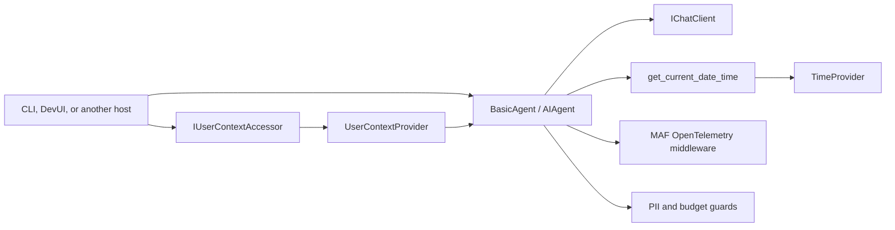

# Basic agent

[Documentation home](../../../../docs/README.md) ·
[Beginner walkthrough](../../../../docs/start-here.md)

`basic-agent` is the smallest conversational Microsoft Agent Framework (MAF)
example in this repository. It combines a provider-neutral chat model, trusted
application context, a deterministic tool, and OpenTelemetry instrumentation
without placing host or provider setup inside the agent.

## Problem and learning goals

A conversational assistant sometimes needs facts it cannot reliably generate:
the user's time zone comes from the application, and the current instant comes
from a clock. This example demonstrates how to combine those inputs while
keeping conversation semantic and factual operations deterministic.

Use it to learn how to compose an `AIAgent`, expose a typed C# capability as a
tool, supply trusted context, and test the boundaries without a live model.
The clock is deliberately small so the architecture remains easy to follow.

## Prerequisites

Use the SDK pinned by [`global.json`](../../../../global.json) and a configured
chat provider. The [beginner walkthrough](../../../../docs/start-here.md) provides
local Ollama setup. Docker, PostgreSQL, embeddings, and a telemetry collector are
not required for this solution. Commands below run from the repository root;
set `AI_MODEL` when a command does not pass `--model` explicitly.

## Architecture



| Component | Kind | Responsibility |
| --- | --- | --- |
| [`BasicAgent.cs`](./BasicAgent.cs) | Agent composition | Defines the identity, instructions, tools, context providers, and telemetry middleware. |
| [`UserContextProvider.cs`](../../Context/UserContextProvider.cs) | MAF context provider | Adds trusted, host-supplied user context to each invocation. |
| [`UserContext.cs`](../../Context/UserContext.cs) | Application contract | Represents context as a generic key/value bag exposed through `IUserContextAccessor`. |
| [`CurrentDateTimeTool.cs`](../../Tools/CurrentDateTimeTool.cs) | Deterministic tool | Resolves the exact date and time for a required time-zone identifier. |
| `IChatClient` | Provider-neutral model boundary | Supplies the model used by MAF; dependency injection resolves the provider outside this folder. |

## Request flow

1. The host resolves an `IChatClient` from a selector such as
   `ollama:llama3.1:8b` and creates the agent through dependency injection.
2. Before a model invocation, `UserContextProvider` serializes the current
   host-owned context as JSON and adds it to the MAF invocation context.
3. The model answers directly or calls `get_current_date_time` when the answer
   depends on an exact date or time.
4. The tool requires a time-zone ID. For a user-relative request, the model uses
   the trusted `time_zone` context value; it must not guess one when it is absent.
5. The tool uses `TimeProvider`, converts the UTC instant with `TimeZoneInfo`, and
   returns a typed `CurrentDateTimeResult`.
6. Agent instructions require exact dates, numbers, identifiers, amounts, and
   units returned by tools to be preserved in the final answer.
7. The selected guard profile inspects input/output, counts tool calls, and
   applies one shared budget to every model turn in the run.

The CLI's local `IUserContextAccessor` supplies `TimeZoneInfo.Local.Id`. A web
host should replace it with a request-aware implementation derived from trusted
user or tenant data; the server's local time zone is not a user identity.

## Why context and the clock are separate

The user's time zone is contextual application data. Reading the clock and
performing a time-zone conversion is a deterministic capability. Keeping them
separate lets another host provide more context fields without growing the tool
contract, while the same clock tool remains reusable by other agents.

The tool intentionally does not use `DateTime.Now`. Its injected `TimeProvider`
makes time-dependent behavior deterministic in tests.

The model owns conversational interpretation and tool selection. C# owns clock
access, argument validation, and time-zone conversion. A workflow would add no
useful process constraint here: the conversation does not have a fixed sequence
of semantic steps. Compare the [translation workflow](../../Workflows/Translation/README.md)
when ordering, fan-out, validation, and retry must be represented explicitly.

## Provider, host, and state boundaries

- The agent depends on `IChatClient`, not an Ollama- or cloud-specific SDK.
- Provider selection, endpoints, credentials, and decorators belong to the
  composition root and provider adapters.
- The reusable agent library does not depend on the CLI or DevUI.
- Conversation history belongs to the MAF agent session. User context is rebuilt
  for each invocation and is not long-term memory.
- The tool keeps no mutable global state.

The CLI composes `BasicAgent` directly. The reusable
[`BasicAgentEntity`](../../../MafPlayground.AI.Samples/Agents/BasicAgent/BasicAgentEntity.cs)
adds typed request/response contracts and optional stored sessions for entity
hosts. Its HTTP sample uses development authentication and opt-in process-local
session storage. These are separate hosting choices, not requirements of the
clock tool. See the [runtime session limits](../../../MafPlayground.AI.Runtime/README.md).

## Run and inspect

Start an interactive session:

```bash
dotnet run --project src/MafPlayground.CLI -- \
  agent basic --model ollama:llama3.1:8b
```

Run one request and show lifecycle and tool-call events:

```bash
dotnet run --project src/MafPlayground.CLI -- \
  agent basic --prompt "What date and time is it for me?" --watch
```

For this prompt, expect the model to call `get_current_date_time` and preserve the
returned date, time, and zone. Inspect tool-call events with `--watch`; do not
treat plausible wording as proof of tool execution. Model behavior varies, and
the instructions alone do not guarantee factual preservation.

Inspect the entity and its input contract:

```bash
dotnet run --project src/MafPlayground.CLI -- inspect agent basic-agent --view-input
```

It is also registered as `basic-agent` in the local DevUI host:

```bash
dotnet run --project src/MafPlayground.CLI -- devui
```

## Failure behavior

- Missing user-specific context is not guessed; the model is instructed to ask
  for it.
- A missing or unavailable time-zone identifier is rejected by the tool with an
  `ArgumentException`.
- Model timeouts are applied by the shared `IChatClient` resilience decorator,
  not by the agent or tool.
- Provider and host startup failures are handled by the host surface.
- PII can be allowed, redacted, or blocked independently at input, output, and
  tool boundaries. Strong output inspection intentionally produces buffered
  rather than token-by-token streaming.
- Budget exhaustion short-circuits before the next model or tool call.

## Testing and extension points

| Evidence | What it verifies |
| --- | --- |
| [BasicAgentTests](../../../../tests/MafPlayground.Tests/AI/Agents/BasicAgentTests.cs) | Injected model client, trusted context, tool exposure, actual deterministic tool execution under budget guards, PII handling, and telemetry/error behavior. |
| [CurrentDateTimeToolTests](../../../../tests/MafPlayground.Tests/AI/Tools/CurrentDateTimeToolTests.cs) | Exact clock values with fixed time, invalid time-zone rejection, and stable function metadata. |
| [InteractiveAgentConsoleTests](../../../../tests/MafPlayground.Tests/CLI/Execution/InteractiveAgentConsoleTests.cs) | CLI conversation and streaming behavior with controlled clients. |
| [BasicAgentEntityTests](../../../../tests/MafPlayground.Tests/AI/Foundation/BasicAgentEntityTests.cs) | Typed entity execution and session-related behavior. |

Run the focused agent and clock tests:

```bash
dotnet test tests/MafPlayground.Tests/MafPlayground.Tests.csproj \
  --filter 'FullyQualifiedName~BasicAgentTests|FullyQualifiedName~CurrentDateTimeToolTests'
```

These are deterministic tests, not a measurement of model quality. For a selected
real model, separately check tool selection, correct use of trusted context,
preservation of returned facts, and whether missing information produces a
clarifying question. Include conversational prompts that do not need the clock,
and repeat representative cases to expose variability. Do not assert exact prose
unless wording is the contract.

There is no versioned Basic agent quality dataset in this repository yet. The
[evaluation project](../../../../tests/MafPlayground.Evals/README.md) demonstrates
that approach for the help agent; its results do not establish this agent's
quality. See the [test guide](../../../../tests/README.md) for suite boundaries.

## Reuse in a client project

1. Keep provider selection and credentials in the host/adapters. Supply an
   `IChatClient` without introducing SDK types into agent or tool contracts.
2. Implement `IUserContextAccessor` using trusted request/user data. Supply only
   the context the agent needs; do not use a server time zone as user identity.
3. Adapt the instructions and add narrow tools for application capabilities.
   Keep validation and business rules in deterministic services behind them.
4. Choose a session lifetime and storage implementation for the host. Configure
   timeouts, guard profiles, authentication, and telemetry for the environment.
5. Preserve deterministic tests and add real-model cases for the client's tasks.

The source files in this folder are compiled into `MafPlayground.AI.Samples`;
shared runtime concerns belong to `MafPlayground.AI.Runtime`. Consult the
[source layout](../../README.md) before copying project references.

## Limits before production

CLI and DevUI are local development surfaces. The HTTP sample refuses to start
outside Development because its header authentication is not production
authentication. In-memory sessions expire and disappear on restart. The sample
PII inspector uses regexes and is not a complete data-protection policy.

Trusted-context instructions and exact-value instructions guide the model; they
do not provide deterministic enforcement of every final answer. Evaluate the
intended model and add application-level validation when downstream behavior
depends on response facts. Review the [repository limitations](../../../../README.md#current-limitations)
before adapting the example for deployment.

Next: [translation workflow](../../Workflows/Translation/README.md) for explicit
orchestration, or [Basic RAG](../BasicRagAgent/README.md) for document-grounded
answers. Return to the [solution catalog](../../../../docs/README.md#solutions)
for the full map.
